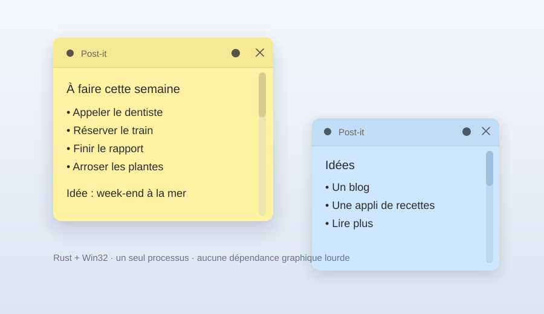

# Post-it

[](https://github.com/khrone18/postit/actions/workflows/ci.yml)

Des post-it natifs pour le bureau Windows, écrits en **Rust** avec l'API **Win32**.
Pas d'Electron, pas de WebView, pas de framework graphique : une fenêtre native par
note, un contrôle d'édition natif et GDI pour le rendu.



## Fonctionnalités

- Notes collées au bureau : elles passent derrière les autres applications dès
  qu'elles perdent le focus, et restent visibles sur le bureau.
- Fenêtres sans bordure : déplacement par la barre du haut, redimensionnement par
  les bords, coins arrondis (Windows 11) ou région arrondie (Windows 10).
- Six couleurs de papier : clic sur la pastille pour changer de couleur.
- Texte brut avec toutes les interactions natives : curseur, sélection, annuler /
  rétablir, copier / coller, molette, retour à la ligne, barre de défilement.
- Icône dans la zone de notification (tray) : clic gauche = nouvelle note, clic
  droit = menu (nouvelle note, tout masquer/afficher, lancement au démarrage,
  quitter).
- Raccourci global **Ctrl+Alt+N** pour créer une note depuis n'importe où.
- Sauvegarde automatique, restauration au démarrage, instance unique.
- Interface en français, Unicode complet.

## Utilisation

1. Télécharger `postit.exe` depuis la page [Releases](https://github.com/khrone18/postit/releases).
2. Le placer où vous voulez et le lancer. Aucune installation, aucun runtime.
3. Clic gauche sur l'icône du tray (ou **Ctrl+Alt+N**) pour créer une note.
4. Le menu du tray permet d'activer le lancement au démarrage.

Les notes sont enregistrées dans :

```
%APPDATA%\PostIt\notes.json
```

L'écriture est atomique (fichier temporaire puis renommage) et différée de 700 ms
après la dernière modification. Un fichier illisible est conservé sous
`notes.corrupt.json` au lieu d'être écrasé.

## Compilation

### Sous Windows

Prérequis : [Rust](https://rustup.rs) et les Build Tools Visual Studio (C++).

```powershell
cargo build --release
```

L'exécutable est dans `target\release\postit.exe`.

### Depuis Linux (cross-compilation)

```bash
sudo dnf install mingw64-gcc mingw64-binutils rust-std-static-x86_64-pc-windows-gnu
rustup target add x86_64-pc-windows-gnu   # si vous utilisez rustup
cargo build --release --target x86_64-pc-windows-gnu
```

Le fichier `.cargo/config.toml` configure le linker mingw pour cette cible.

Un test rapide est possible avec Wine :

```bash
wine target/x86_64-pc-windows-gnu/release/postit.exe
```

### Intégration continue

- `.github/workflows/ci.yml` compile le projet sur `windows-latest` à chaque
  push et propose l'exécutable en artefact.
- `.github/workflows/release.yml` construit et publie automatiquement une Release
  GitHub avec `postit.exe` lorsqu'un tag `v*` est poussé.

## Architecture

| Élément | Choix | Raison |
|---|---|---|
| Fenêtres | Un `HWND` par note, boucle de messages unique | Quelques Ko par note |
| Texte | Contrôle `EDIT` natif multiligne | Curseur, sélection, undo, presse-papiers gratuits |
| Rendu | GDI, polices et pinceaux mis en cache | Aucun bitmap persistant, aucune allocation par frame |
| Bureau | Fenêtres `WS_EX_TOOLWINDOW` renvoyées en bas de la pile à la perte de focus | Visibles sur le bureau, derrière les applis |
| Tray | `Shell_NotifyIcon` | Aucune fenêtre principale |
| Persistance | JSON + écriture atomique | Lisible et robuste |
| DPI | Conscience Per-Monitor V2, polices recréées par DPI | Net sur écrans HiDPI |

## Performances

- Binaire release : **moins d'1 Mo**, icône comprise (`opt-level="z"`, LTO, strip,
  panic=abort).
- Un seul processus, aucune dépendance graphique lourde.
- Aucun timer actif au repos ; le timer de sauvegarde n'existe que pendant
  l'édition.
- Aucun bitmap ni contexte GDI persistant : uniquement des pinceaux, stylos et
  polices partagés, créés à la demande.

La consommation dépend du nombre de notes et de la version de Windows. L'objectif
est de rester dans l'ordre de **10 Mo** de mémoire de travail pour quelques notes.
Une mesure sous Wine n'est pas représentative (Wine charge ses propres DLL) ; la
mesure utile est à faire sur Windows avec le Gestionnaire des tâches.

## Limites de la version 0.1

- Texte brut uniquement (pas de gras, listes, images ou Markdown).
- Pas de synchronisation entre machines ni de rappels.
- Les notes ne sont pas épinglées au-dessus des autres fenêtres : elles vivent sur
  la couche du bureau.
- Pas d'installeur : un simple exécutable portable.

## Licence

[MIT](LICENSE) © 2026 Aurélien CASTEL
